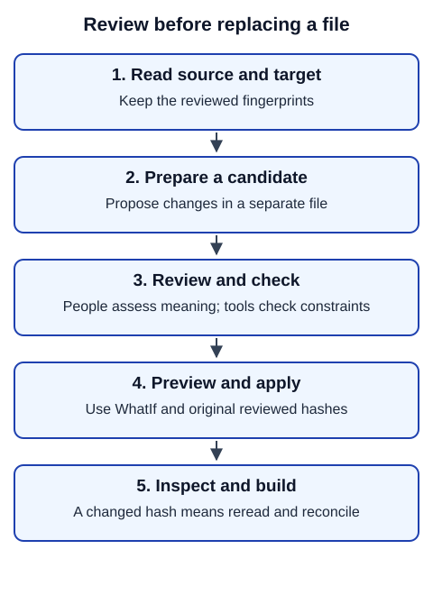

# Understand files and changes

You can review words without learning the site's file formats. The agent or a volunteer can handle them while you focus on what readers will understand.

## Work with an agent

Use [guide.transstatus](../skills/guide.transstatus/SKILL.md) to identify the selected work without editing. If the agent cannot access the project or skill, start with [setup](setup.md).

> Use this site's installed **guide.transstatus** skill to identify the files involved in our agreed translation. Do not change files. Explain which words readers see, which settings must stay intact, and what is still unknown. Use actual findings, not another site's file list. Explain unfamiliar terms as they arise.

**You should receive:** a short explanation connected to your chosen language and guide. You do not need to supply technical file identifiers yourself.

For example, in `Download {{ .Site.Title }}`, translate “Download” but keep `{{ .Site.Title }}` intact: the software fills that part in. In a link, the words may change while the address stays the same.

**You decide:** the proposed words, not whether an unfamiliar software setting should be translated. Ask the agent to flag uncertain fields. Approved file changes must use the appropriate installed skill on [add a language](add-language.md), [translate a guide](translate-guide.md) or [update a translation](update-translation.md).

**Next:** return to [your first translation](first-translation.md). The explanation below is optional background, not a prerequisite for wording review.

## I do not have an agent and want to do this manually

Use this background when you want to handle files yourself. Markdown stores text with simple heading/link marks; YAML and JSON store structured settings and messages. A separate proposed version is called a candidate. The following explanations show why file checks and review are separate steps.

A guide page is usually Markdown: plain text with marks for headings, emphasis and links. A front matter block at its beginning stores settings. YAML and JSON hold settings and interface messages. You translate agreed reader-facing values while preserving identifiers, addresses and placeholders that the software uses.

For example, in `Download {{ .Site.Title }}`, translate “Download” but keep `{{ .Site.Title }}` intact. In `[Read the guide](guide-url)`, translate the label and preserve the destination. A custom field is not automatically editable just because it contains English.

## Why use a candidate?

A candidate is a separate proposed version. Review it before asking the platform to replace the existing file. A hash (SHA-256 fingerprint) identifies the exact source or target bytes you reviewed. If another person changes a file, the old fingerprint no longer matches; reconcile the change rather than substituting a new hash blindly.

In words: read the actual source and destination; prepare a candidate; have people review it and run the supported check; preview the operation with `-WhatIf`; apply against the original reviewed hashes; inspect the diff and build. A stale hash returns you to reading and reconciliation. A check does not approve the translation's meaning.

## What gets shared?

`git diff` shows edits you have not yet selected for a commit. `git diff --cached` shows the selected (staged) edits. `git status --short` also lists new, untracked files, which neither diff includes until you stage them. A commit saves a selected set of changes locally. A push sends commits to GitHub. A pull request asks the site team to review and merge them. These are separate actions, and none alone approves production publication.

Keep `.processing`, private coordination, raw assistant logs and unconsented personal information out of commits. Preserve protected PDFs, routing metadata, explicit anchors and intentional formatting. Do not add `lang`, fonts or attribution fields to guide front matter; follow [credits and PDFs](credits-pdfs.md).

**Next:** [translation journey](translation.md) or [content changes](content.md). **Recovery:** [stale files and other failures](troubleshooting.md).
