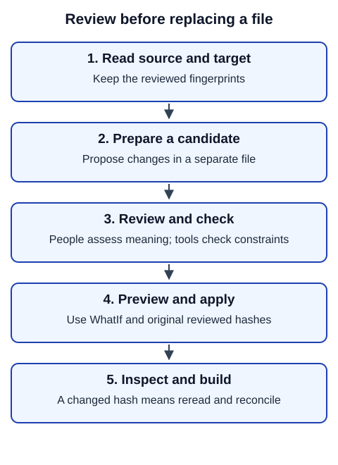

# Understand files and changes

A guide page is usually Markdown: plain text with marks for headings, emphasis and links. A front matter block at its beginning stores settings. YAML and JSON hold settings and interface messages. You translate agreed reader-facing values while preserving identifiers, addresses and placeholders that the software uses.

For example, in `Download {{ .Site.Title }}`, translate “Download” but keep `{{ .Site.Title }}` intact. In `[Read the guide](guide-url)`, translate the label and preserve the destination. A custom field is not automatically editable just because it contains English.

## Why use a candidate?

A candidate is a separate proposed version. Review it before asking the platform to replace the existing file. A hash (SHA-256 fingerprint) identifies the exact source or target bytes you reviewed. If another person changes a file, the old fingerprint no longer matches; reconcile the change rather than substituting a new hash blindly.

In words: read the actual source and destination; prepare a candidate; have people review it and run the supported check; preview the operation with `-WhatIf`; apply against the original reviewed hashes; inspect the diff and build. A stale hash returns you to reading and reconciliation. A check does not approve the translation's meaning.

## What gets shared?

`git diff` shows edits you have not yet selected for a commit. `git diff --cached` shows the selected (staged) edits. `git status --short` also lists new, untracked files, which neither diff includes until you stage them. A commit saves a selected set of changes locally. A push sends commits to GitHub. A pull request asks the site team to review and merge them. These are separate actions, and none alone approves production publication.

Keep `.processing`, private coordination, raw assistant logs and unconsented personal information out of commits. Preserve protected PDFs, routing metadata, explicit anchors and intentional formatting. Do not add `lang`, fonts or attribution fields to guide front matter; follow [credits and PDFs](credits-pdfs.md).

**Next:** [translation journey](translation.md) or [content changes](content.md). **Recovery:** [stale files and other failures](troubleshooting.md).
