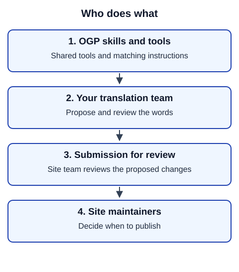

# How the work fits together

The guide site owns the words and publication decisions. OpenGuidePlatform (OGP) supplies shared tools and instructions. Your agent follows the skills installed for that site.

## Work with an agent

Start with [setup](setup.md) if the agent cannot access the site. Then ask:

> Use this site's installed **guide.transstatus** skill to inspect our chosen language without changing files. Explain which work belongs to the website, which belongs to the guide, and what needs a maintainer or language reviewer. Identify the installed version and actual report used. If you cannot inspect them, say so rather than guessing.

This uses [guide.transstatus](../skills/guide.transstatus/SKILL.md). **You should receive:** a map of the actual work and who can help, not a demand that you learn the site's software architecture.

The agent can handle supported file operations; you and the language reviewers assess meaning. A maintainer handles site access and review arrangements. Ask them for missing access or capabilities instead of accepting an invented workaround.

**Next:** [your first translation](first-translation.md). The extra background below is for people who want to understand or operate the files themselves.

## I do not have an agent and want to do this manually

### Before you start

This page explains responsibility; it does not require commands or installation. A maintainer handles the site's technical operation. The site's language reviewer or guardian settles editorial decisions according to its policy.

### Choose your next step

OGP supplies shared commands and skills. The guide site owns its content, layout, local policy and publication decisions. People propose and review the words. The website around a guide includes menus, homepages, history and translation listings; translating a guide body alone does not translate those pages.

For actual work, start with [manual setup](setup.md#i-do-not-have-an-agent-and-want-to-do-this-manually) and [status](status.md#i-do-not-have-an-agent-and-want-to-do-this-manually). Commands use the runtime already selected by the site. If it lacks a capability, ask the maintainer to update that installation and provide matching instructions. Installing a newer contributor module must not silently upgrade it.

### Check the result

You know who reviews language, who helps with files, and who decides publication. A report or draft does not replace any of those people or their actual approval.
