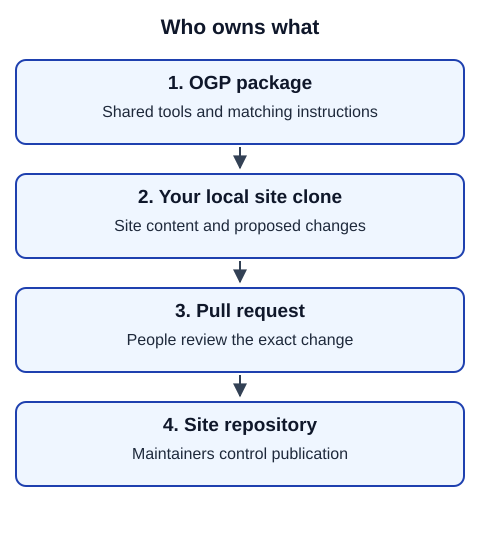

# How the system fits together

OpenGuidePlatform (OGP) supplies shared building and publishing tools. A guide site owns its content, design choices and publication decisions. Your computer holds a working copy of that site's repository, called a clone.

In words: the installed OGP package supplies commands and matching instructions. You use those commands against the local site files. You submit the reviewed changes to the site's repository through a pull request. Site maintainers decide when those changes reach readers.

| Owner | What belongs there |
|---|---|
| OGP | Reusable procedures, commands, validation, shared templates and these diagrams |
| Guide site | Guide content, wrapper design, editorial rules, guardian contacts and delivery configuration |
| Translation team | Proposed text, glossary decisions and review findings |

The wrapper is the website around a guide: homepages, navigation, buttons, history and translation listings. Translating a guide body alone does not translate that experience. A site may have any number of guides and editions.

Build output goes under `.processing` and is temporary. Do not commit it or edit downloaded platform files. Platform fixes belong in OGP; maintainers adopt a released fix through the coordinated update procedure.

**Next:** [set up your computer](setup.md), or [choose a task](README.md).
