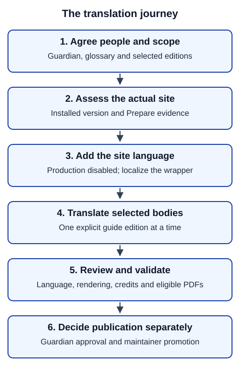

# Translation journey

The goal is a complete reader experience whose wording people have reviewed. The guardian decides editorial questions; translators propose wording; reviewers check it; a technical volunteer operates commands; maintainers arrange review environments and publication. One person may have several roles.

In words: agree people and terminology, inspect the actual site, introduce the language around the guides, then translate separately selected guide editions. Review rendering and language, resolve feedback, and obtain publication approval. Keep the new language excluded from production throughout preparation.

## Before translating sentences

Agree language and regional variant, guide editions, reviewers and the person who resolves disagreements. Build a glossary. Discuss conventions that may not survive translation: meaningful capitals, adaptation italics, reading direction and fonts. Record unresolved choices rather than letting software decide them. Follow the site's rules for licences, acknowledgements, consent and minimum reviewer counts; these are not universal OGP rules.

Use the [translation playbook](../translation-playbook.md) for team handoffs and scoped assistant requests. Then follow:

1. [Assess readiness](status.md).
2. [Add the site language](add-language.md), leaving guide bodies for the next stage.
3. [Translate selected guides](translate-guide.md).
4. [Record credits and prepare eligible PDFs](credits-pdfs.md).
5. [Validate and submit](validation.md).

An optional `docs/translations/LANGUAGE/` folder in the site can retain the glossary, proposed/agreed decisions, source revisions and review notes. Link actual approvals and identify the exact candidate or rendered artifact. These notes are context, not an inventory or automatic permission to publish. Later use [reconciliation](update-translation.md).
