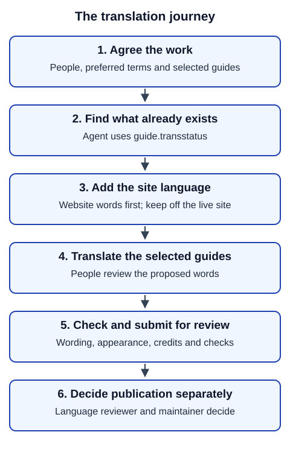

# The translation journey

The goal is a website and selected guides that people can read comfortably in their language. Translation includes the menus and introductory pages, not just the guide body.

## Work with an agent

Follow [your first translation](first-translation.md) for the complete journey and requests to paste. That page uses these installed skills in sequence:

1. [guide.transstatus](../skills/guide.transstatus/SKILL.md): find what exists and agree the work.
2. [guide.transcreate](../skills/guide.transcreate/SKILL.md): prepare the website language, then separately translate the selected guide editions.
3. [guide.contributions](../skills/guide.contributions/SKILL.md): record the consented credits. Use [guide.genpdfs](../skills/guide.genpdfs/SKILL.md) only for eligible generated PDFs.
4. [Check and submit](validation.md): complete the translation skill's checks and use the site's review process. There is no separate submission or publication skill.
5. Later, [guide.transreconcile](../skills/guide.transreconcile/SKILL.md): update reviewed translations when the source changes.

If you are not yet using an agent with site access, start with [setup](setup.md). Missing skills or unsupported operations require maintainer help, not a generic agent workflow.

**You decide:** the language, selected guides, preferred terms and wording, with the site's reviewers. Discuss source conventions such as meaningful italics or capitals rather than assuming software knows how they should transfer.

**You should receive:** proposed words beside their source, clear human decisions, a viewable result or a maintainer arranging one, actual check results and a submission or explicit handoff. Keep the language excluded from the live site throughout preparation. Existing translations and PDFs stay intact.

**Next:** [your first translation](first-translation.md). You can also [review wording](review-wording.md) while someone else operates the skills.

## I do not have an agent and want to do this manually

### Before you start

This page is a journey map. Agree language, regional variant, selected guide editions, preferred terms and reviewers with the site team. Discuss source conventions such as meaningful capitals or italics before assuming how they transfer.

### Choose your next step

Follow [the complete manual journey](first-translation.md#i-do-not-have-an-agent-and-want-to-do-this-manually): setup → status → website wording → selected guide text → credits/PDFs → checks and submission. That page links to the commands and expected results for each task. If you only want to supply words, use [review wording](review-wording.md#i-do-not-have-an-agent-and-want-to-do-this-manually) with a volunteer handling the files.

Keep useful agreed terms, reviewer decisions, source version and unanswered questions for the next volunteer. Someone handling the files can maintain optional notes under `docs/translations/LANGUAGE/`; creating that folder is not a prerequisite for you to translate. Keep personal/private material out of public notes.

### Check the result

The team can trace reviewed words and unresolved work to the actual source and submitted changes. The language stays off the live site while being prepared. Technical review, language approval and publication remain separate.
