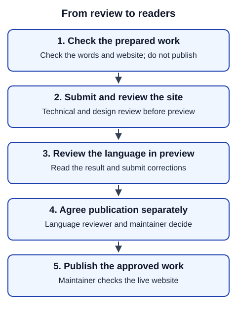

# Check and submit your translation

Submission asks the site team to review your work. It does not publish the language. You should be able to show what changed, what people reviewed and what remains unfinished.

## Work with an agent

Continue with the installed skill used for the work: [guide.transcreate](../skills/guide.transcreate/SKILL.md) for adding a language or selected guide translation, or [guide.transreconcile](../skills/guide.transreconcile/SKILL.md) for updates. Their workflows include the required checks. If the agent cannot load the appropriate skill, use [setup](setup.md) with the maintainer; do not substitute another workflow.

> Continue our work through this site's installed **guide.transcreate** skill. Check the exact changes we reviewed using its required preview and production checks. Do not publish anything. Explain the results, including failed or missing checks. Show how we can inspect the prepared website. Prepare a submission description with the agreed scope, source used, human review, credits, actual check results and unfinished work. Follow the site's permissions for saving or sharing changes; do not claim a submission exists until you can show its link.

For an update, replace **guide.transcreate** in that request with **guide.transreconcile**. Use [guide.contributions and guide.genpdfs](credits-pdfs.md) only if credits or eligible generated PDFs are part of the agreed work.

### Inspect the result together

The agent should report preview and production check results separately. A production check checks the would-be live output; it does not publish it. Confirm that the new language remains excluded from the live website.

Ask for the prepared website's review address. If none is available, ask the maintainer to arrange one. Inspect menus, language/edition switching, guide text, links, downloads and letters on a phone and larger screen. Review any newly generated PDF separately. The person checking language decides whether wording is right; software checks cannot do that.

### Hand over the submission

A **pull request**, often shortened to PR, is a submission showing proposed file changes for the site team to review. There is no separate OGP submission or publication skill. Submission uses the site's normal GitHub process and permissions, after the skills above complete their checks.

If your agent is authorised and has the necessary access, it can help save and share the reviewed work through that site process. Otherwise, give the maintainer the reviewed work and evidence and ask them to make the submission. You do not need to learn terminal commands to make that handoff.

Check that the submission or handoff includes:

- The language, selected guide and edition, and the source used.
- What changed, including whether guide starting pages are still empty.
- Wording review and consented credits.
- Actual check results, the version checked, and unresolved work.
- A review link, or a named maintainer arranging one.

Ask for the PR link and confirm the intended files appear there. Do not create a second PR if one already exists for the task. A checked website-only stage can be shared as a draft, clearly marked as incomplete guide translation. Do not claim failed checks passed.



The site team arranges technical review, then language review in its preview environment. Later corrections follow the same reviewed-change process. The responsible language reviewer and maintainer make the separate publication decisions. A passing check, agent report or submitted PR is not permission to publish.

**You should receive:** the submission link or an explicit maintainer handoff, the actual review arrangement, and a clear account of anything still blocking completion. If a check fails, use [troubleshooting](troubleshooting.md).

## I do not have an agent and want to do this manually

### Before you start

Complete [setup](setup.md#i-do-not-have-an-agent-and-want-to-do-this-manually) first. The contributor module must be installed and PowerShell must be open in the local folder of your fork, containing `build.ps1`. Start at the first block on this page and keep the same window open; every value used below is set on this page. If you closed the window, reopen that folder and repeat the blocks you need. Apply only the wording people reviewed. Ask the maintainer for the agreed task-branch name, destination site repository and destination branch for the submission. A repository is the project and its history; a branch keeps this task's changes together. Read [files and changes](files.md#i-do-not-have-an-agent-and-want-to-do-this-manually) if those terms are new.

### Run the PowerShell steps

#### Check locally

```powershell
Test-OGPSite
```

This checks preview and production—the review and would-be live outputs—without publishing either. **You should see:** each target's validation result. Look for `Validate: pass`. A clean passing check prints `Artifact checks passed.`; a report with findings prints a table instead. Read those findings even when the outcome is pass. Failed or unavailable checks must not be described as passed.

To inspect the website:

```powershell
Show-OGPSite
```

Copy the local address it prints into your browser. Keep PowerShell open while inspecting, then return there and press **Ctrl+C** to stop the server. Inspect navigation, language/edition switching, wording, links, downloads and how letters look on small and large screens. Open any generated PDF separately. If you cannot produce a review site, ask the maintainer to arrange one and record that visual review is still missing.

#### Save and submit the reviewed change

A **commit** saves selected changes on your computer. A **push** shares those commits with your GitHub fork. A **pull request**, or PR, asks the site team to review and merge them. None publishes the translation by itself. You may hand reviewed words and check results to the maintainer instead of doing these Git steps yourself.

Only continue when the site's checks/review requirements and permissions allow saving and sharing. First run:

```powershell
$expectedBranch = Read-Host 'Enter the task-branch name agreed with the maintainer'
git branch --show-current
git status --short
git diff
```

**You should see:** the agreed branch and only the intended edits. If the branch differs, stop and ask; do not switch it back automatically. In status, `M` marks a changed tracked file and `??` a new file. They are labels, not part of the file path. `git diff` shows changes to existing files; open new files in your editor too.

Choose one reviewed file at a time:

```powershell
$reviewedPath = Read-Host 'Copy one intended file path from status, without its M or ?? label'
git add -- $reviewedPath
git diff --cached
git status --short
```

`git add` selects the file for your next commit; it is normally silent on success. `git diff --cached` shows the selected changes. Repeat only for additional intended files. Exclude `.processing` drafts/reports, private data and unrelated work. Include generated PDFs only when explicitly reviewed as part of the task; preserve supplied originals. If the selection is wrong, ask for help before committing rather than saving an accidental selection.

When the selected changes are correct and committing is authorised:

```powershell
$message = Read-Host 'Enter a short description of the reviewed change'
git commit -m $message
git rev-parse --short HEAD
git status --short --branch
```

**You should see:** a successful commit and its short identifier. Account for any files still uncommitted. If Git needs your public author name/email or a hook fails, follow the site's setup/check instructions; do not invent identity details or turn checks off.

Before pushing, inspect the destination:

```powershell
git remote -v
git branch --show-current
```

`origin` is the saved address where the next push sends the work. It should be the expected fork or repository agreed with the maintainer. If the address or branch is wrong, stop and ask; do not change it by guesswork. When pushing is authorised and both are correct:

```powershell
if ((git branch --show-current) -cne $expectedBranch) { throw 'Branch changed; ask the maintainer before pushing.' }
git push -u origin $expectedBranch
```

Git should report the branch was sent successfully. If sign-in or the push fails, preserve the error and ask the team; do not claim the work has been submitted.

#### Open the pull request on GitHub

Open the original guide site's GitHub repository. After a successful push, GitHub may offer **Compare & pull request**. Use **compare across forks** to choose the original site and agreed destination branch, then your fork and task branch. The destination is where the team will receive your work; the source is where you pushed it. Follow [GitHub's illustrated fork-submission steps](https://docs.github.com/en/pull-requests/how-tos/create-pull-requests/creating-a-pull-request-from-a-fork) if you cannot locate the controls.

Check the changed-files view before submitting. Include language/guide/edition, source and comparison version if used, wording review, consented credits, actual check results and unfinished work. Choose a draft submission if text or review remains incomplete. If this task already has a PR, later pushes to its branch update it; do not open another.

### Check the result

Open the submitted PR link and confirm its intended files and actual status. Ask the maintainer for a temporary review website if fork submissions cannot deploy one. The team completes technical review before language review in preview. Later corrections still go through review. Guardian wording approval and maintainer production approval remain separate; keep permanent exclusions intact. [Command reference](../../OpenGuidePlatform.PowerShell.Contributor/README.md#check-and-submit).

If a command fails, stop at that step. Send the maintainer the page, step, expected result and exact visible error. Include the printed report folder if available; leave out passwords and access tokens. Do not change software versions, delete existing files or bypass a refusal to make the command continue.
