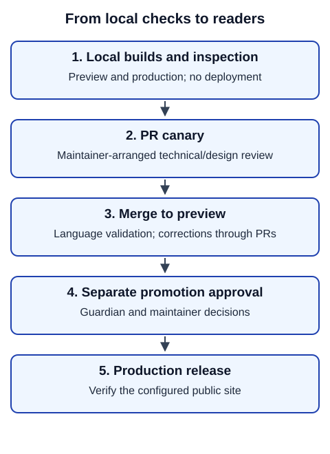

# Validate, review and publish

Validation checks that the site builds and behaves as intended. People approve wording and publication. Start with the reviewed candidate applied and its actual diff inspected. Use the same installed package as [Prepare](status.md).

## Check locally

From the site root in the same PowerShell session:

```powershell
./build.ps1 -Target preview -PlatformSource Path -PlatformPath $platform
./build.ps1 -Target production -PlatformSource Path -PlatformPath $platform
```

Require successful exit codes and inspect reports; explain warnings and resolve errors. A production build checks the production output without publishing. Confirm the new language is excluded there. Use the output paths printed by the build to find reports and rendered files; do not assume an old artifact belongs to this change.

For interactive local inspection, the site development server is:

```powershell
./build.ps1 -Stage Serve -Target local
```

Open its printed address and stop it with Ctrl+C when done. A development server does not replace the two full builds. Inspect homepage/navigation, language and version switching, history, fallback, links, downloads, narrow/wide layouts and representative script rendering. Check any generated PDF separately. Record the revision or exact candidate, package version, target and artifact inspected.

## Share reviewed work



In words: local checks precede a PR. A maintainer arranges the canary for technical/design review. After technical review, merge to preview for native-speaker validation. Resolve later corrections through PRs, then obtain guardian approval and a separate production-promotion decision. Actual deployment depends on the site's configured workflow and access.

Review `git status` and `git diff`; stage only intended source files and approved artifacts. Follow the site's commit/push permissions and PR instructions. Include scope, source/candidate revisions, build results, review findings, consented credits and remaining issues. Never commit `.processing` output. Ask maintainers for the review link if fork PRs cannot deploy; approval alone cannot override a disabled deployment caller.

With an assistant: “Run the required local checks on this exact change. Report evidence, failures and unreviewed wording separately. Prepare a PR description; follow the site's permissions for commits, pushes and publication.”

## Save and submit the reviewed change

The technical volunteer performs these actions after the site's required checks/review and Git authorisation. A commit saves locally; push shares it; a PR requests review. Translators who only supply text do not need to run them.

First inspect the branch and changes:

```powershell
git branch --show-current
git status --short
git diff
```

Confirm the branch is the agreed task branch. Stop if it changed unexpectedly. Check every changed file against scope. `git diff` shows tracked edits; open new files listed by status separately. Do not include `.processing`, credentials or unrelated work. Reviewed generated PDFs/receipts are included only when explicitly part of this task; supplied/protected PDFs stay unchanged.

Select one intended repository-relative file at a time, then review the whole staged change:

```powershell
$reviewedPath = Read-Host 'Enter one reviewed file path to include'
git add -- $reviewedPath
git diff --cached
git status --short
```

Repeat selection only for additional intended files. If the staged diff is wrong, stop and correct the selection before committing. When it is correct and committing is authorised:

```powershell
$commitMessage = Read-Host 'Enter a short description of this reviewed change'
git commit -m $commitMessage
git status --short --branch
```

Confirm Git reports a successful commit and account for anything still uncommitted. If a hook or command fails, report it and resolve the cause; do not bypass checks. When pushing is authorised under the site's rules, verify that `origin` is the expected fork or repository and that the current branch is still the agreed task branch:

```powershell
git remote -v
git branch --show-current
$agreedBranch = Read-Host 'Enter the agreed task branch name shown above'
if ((git branch --show-current) -cne $agreedBranch) { throw 'Branch changed; stop and check with the maintainer.' }
git push -u origin $agreedBranch
```

Open the site's GitHub repository in your browser and choose the option to create a pull request from the pushed branch. Select the intended destination repository/base branch and your fork/task branch as the comparison. Review the displayed changed files, link the agreed discussion and include the validation evidence and unresolved questions. Select a draft PR while work or review is still in progress. Do not create another PR if the task already has one; subsequent pushes update it. Follow the site's contribution agreement and review requirements when GitHub requests them.

Success here is a PR that shows the intended changes and their actual status. A draft PR can make website/scaffold work visible before guide bodies are translated; say so explicitly. Maintainers then arrange canary/preview review. Creating a PR does not merge it or publish a release.

**Success:** checks and human decisions are traceable to the reviewed revision. Passing automation, preview availability and an assistant report are not publication approval. **If a check fails:** use [troubleshooting](troubleshooting.md), retain the failure and rerun affected checks after correction.
